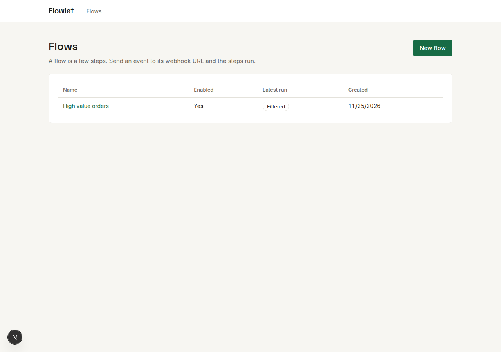
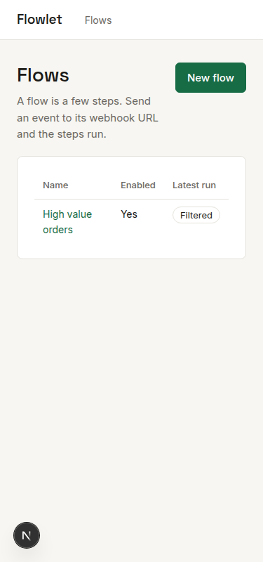
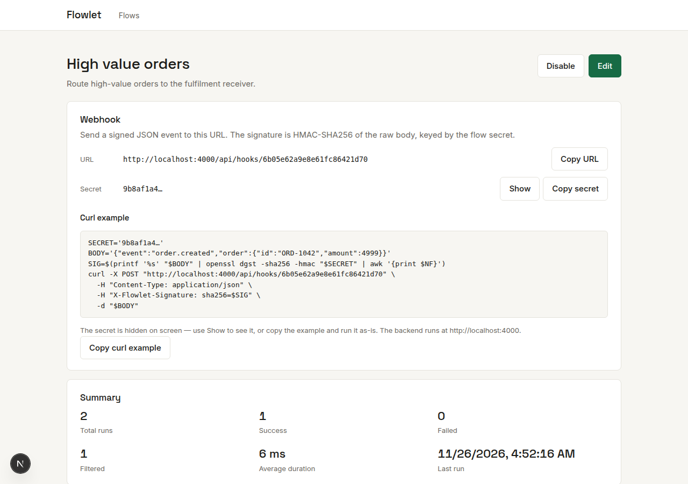
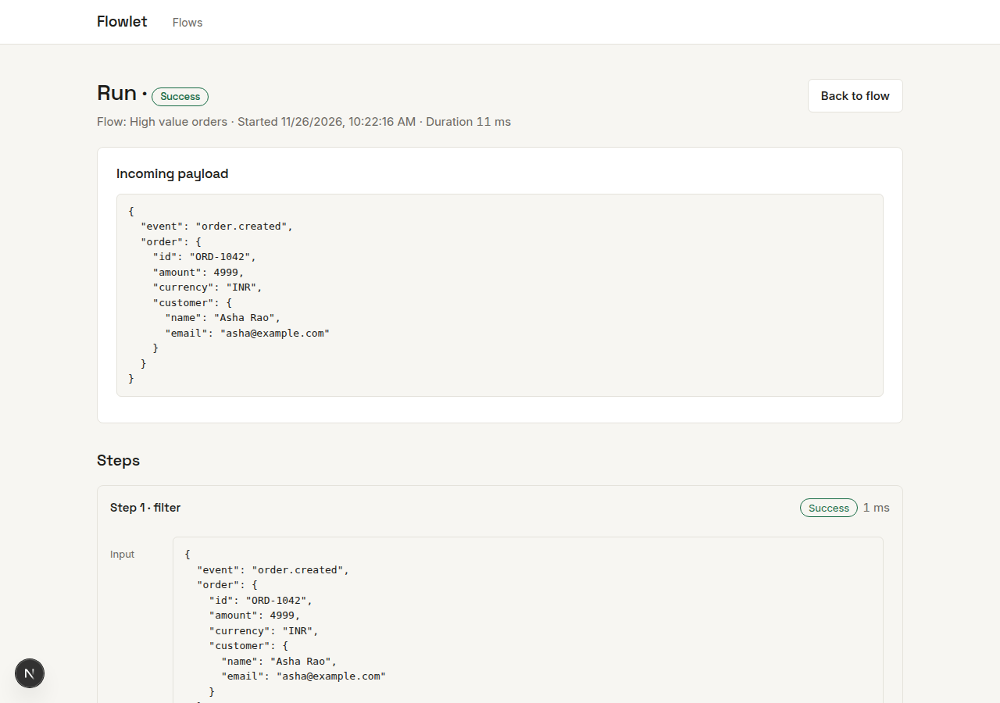
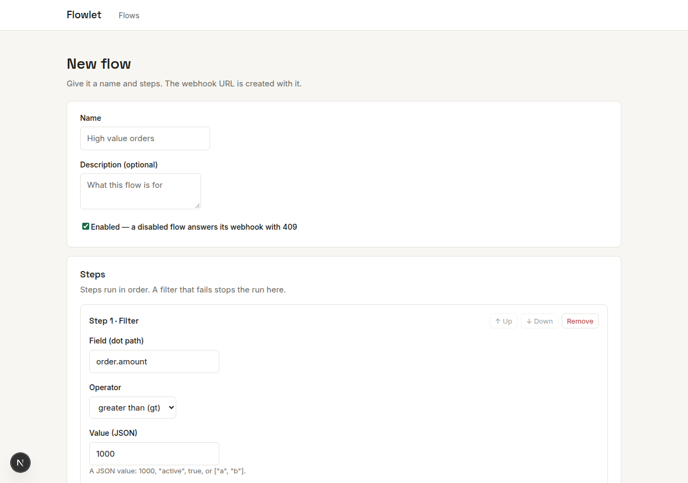

# Flowlet

A mini webhook automation service. A user creates a flow with a few
steps, an outside system sends an event to the flow's webhook URL, and
the service runs the steps in order and records the result as a run.

Built for the Octaviaflow Full Stack Developer Intern take-home
(deadline: Thu 26 Nov 2026, 20:00 IST).

## How to run

From a fresh clone:

```bash
cp .env.example .env
docker compose up -d   # MongoDB and PostgreSQL
bun install
bun run migrate
bun run dev            # backend on http://localhost:4000, web on http://localhost:3000
bun test
```

`bun run dev` starts both servers (backend with watch mode). Stop with
Ctrl-C. The backend also answers `GET /health` and `GET /health/db`
(the second checks both databases and returns 503 if either is down).

`.env.example` holds placeholders only. Never commit `.env`.

## Screenshots

Screenshots of the running app with the demo flow ("High value orders"),
taken 26 Nov 2026.



*The flows list. The demo flow's latest run shows as Filtered.*



*The same list at 375 px wide. The Created column is hidden at this
width so nothing scrolls sideways.*



*A flow's page: webhook URL, the secret hidden until you ask to see
it, a ready-to-copy curl example, and the run summary (2 runs: 1
success, 1 filtered).*



*A run's step-by-step timeline: the 4999 order passes the filter, is
transformed to `{orderId, total, email}`, and the http_request returns
200.*



*The new-flow form, with the first step (a filter on `order.amount`)
filled in.*

## How the code is organised

```
flowlet/
├── backend/            Bun + TypeScript, no framework.
│   ├── src/index.ts    Entrypoint: serves, logs, shuts pools down cleanly.
│   ├── src/app.ts      Route table + request handler (testable without a port).
│   ├── src/config.ts   Environment only; a missing value fails fast by name.
│   ├── src/types.ts    Shared types (Flow, Run, Stats). No `any`.
│   ├── src/validation.ts  Runtime validation of every request body,
│   │                    with field-path errors (e.g. steps.0.field).
│   ├── src/engine.ts   Step execution: dot-path reads, the five filter
│   │                    operators, transform mapping, http_request with a
│   │                    5s timeout, and HMAC sign/verify (timing-safe).
│   ├── src/db/flows.ts    MongoDB: flow documents, secret generation.
│   ├── src/db/runs.ts     PostgreSQL: run + step inserts (one transaction),
│   │                    cursor pagination, stats by SQL.
│   ├── src/db/mongo.ts / postgres.ts   One client / pool each.
│   ├── src/db/migrate.ts  Numbered *.sql runner; never applies a file twice.
│   ├── src/routes/     flows.ts, hooks.ts, runs.ts, mock.ts.
│   ├── migrations/0001_init.sql   runs + run_steps, indexes (see below).
│   └── test/           bun test. setup.ts starts one shared in-memory
│                        MongoDB for the suite (see backend/README.md).
├── frontend/           Next.js (App Router).
│   ├── src/app/        /flows, /flows/new, /flows/[id],
│   │                    /flows/[id]/edit, /runs/[id]. / redirects to /flows.
│   ├── src/lib/api.ts  Typed fetch client; signs test events in the browser.
│   ├── src/lib/validation.ts  Form validation with per-field messages.
│   └── src/components/ FlowForm (add/remove/reorder steps), RunTable
│                        (status filter + Load more), StateViews (loading,
│                        empty, error).
├── docker-compose.yml  Databases only: postgres:16-alpine, mongo:8.
├── scripts/dev.sh      Loads root .env, starts backend + frontend.
└── COMMITS.md / HOURS.md   Commit log and hours log.
```

Things worth knowing:

- **Steps run in the request, in order.** There is no queue (out of
  scope). A filter that returns false records the step as success with
  output `{matched: false}`, marks the rest skipped, and ends the run
  as `filtered`.
- **A transform step replaces the data.** Only transform changes what
  the next step sees; `http_request` posts the current data but does
  not change it. A missing dot path in a transform mapping becomes
  `null`.
- **The hook checks in this order:** flow exists (404), signature
  (401, and no run is recorded), valid JSON (400), flow enabled
  (409), then it runs the steps (200 with `{runId, status}`).
- **The flow list never returns step config or the secret.** The
  secret is only on the single-flow view, hidden on screen until you
  ask to see it, and the page uses it to sign test events.
- **Webhook bodies are capped at 1 MB**, the same cap as the other
  JSON endpoints. An event holding a NUL character gets a 400 before
  any step runs, because PostgreSQL cannot store it.

## What is finished

- All ten API paths from the brief, with the exact shapes and status
  codes, including the error shape `{error: {code, message, details}}`.
- All three step types, HMAC-SHA256 verification with a timing-safe
  compare, the 5s http_request timeout, and the first 2 KB of the
  response body stored as step output.
- Runs and step records in PostgreSQL via a committed migration;
  cursor pagination (newest first, default 20, max 100); stats computed
  by one SQL query; a MongoDB index on the flow list.
- All four frontend pages with loading, empty and error states, labels
  on every field, per-field validation messages, step add/remove/
  reorder, a ready-to-copy curl example, a "Send test event" box that
  signs with the flow secret, run history with a status filter and
  pagination, and a per-run step timeline. Usable at 375 px wide.
- 42 tests (`bun test`), all passing: filter operators, transform
  mapping, signature verification, and API tests that call the
  endpoints for real, including the brief's example end to end.
- The brief's example verified live with curl: amount 4999 gives a
  success run with three steps, the last step's input exactly
  `{orderId: "ORD-1042", total: 4999, email: "asha@example.com"}`;
  amount 500 gives `filtered`, steps two and three skipped.
- `bun run migrate`, `bun run dev`, `bun test`, `bun run typecheck`
  (backend + frontend) and the frontend production build all pass.
  `docker compose config` validates; `bun install` from the root is a
  clean no-op.
- A GitHub Actions workflow (`.github/workflows/ci.yml`) runs type
  checking and tests on push and pull request, with a PostgreSQL 16
  service; the tests bring their own in-memory MongoDB.
- Fixes from a 26 Nov review pass: the flow secret is hidden on the
  flow page until you ask to see it (copy still works); a transform
  output named `__proto__` is kept as a real field instead of being
  lost; empty transform output names are rejected; mapping errors now
  point at the right row in the form; webhook bodies are capped at
  1 MB; an event with a NUL character gets a clear 400 instead of a
  500 with no run recorded.

## Limits

- **No duplicate-event handling.** The same event delivered twice
  creates two runs (see the third question below). The `X-Event-Id`
  extra was not built.
- **No retries.** A failed `http_request` step fails the run at once;
  the retry extra was not built.
- **No live run list.** New runs appear on the flow page after a
  refresh; the live-update extra was not built. Sending a test event
  from the flow page does refresh the summary and history at once.
- **No Docker daemon on the build machine**, so `docker compose up -d`
  itself could not be run here. The compose file was validated with
  `docker compose config`, and the app was verified against a local
  PostgreSQL 16 cluster and a local `mongod` with the same versions
  the compose file pins (postgres:16-alpine, mongo:8).

## Hours spent

About 5 hours 45 minutes. The running log is in [HOURS.md](HOURS.md).

## AI tools used

- Codex 
- No other AI tools were used.

## Questions

### Why do flows fit MongoDB and runs fit PostgreSQL? Would you have chosen differently?

A flow is a small document with a variable shape — its steps are a short
list and each step type carries different fields — so a schemaless document
fits without joins or a step-type table. Runs are append-only, tabular and
relational, and the questions asked of them are aggregations and ordered,
paginated reads, which SQL answers directly. I would not choose differently.

### Which indexes did you create, and which query does each one serve?

MongoDB: `{createdAt: -1}` on flows serves `GET /api/flows`, the newest-first
list. PostgreSQL: `idx_runs_flow_started (flow_id, started_at DESC, id DESC)`
serves `GET /api/flows/:id/runs` — filter by flow, newest first, with cursor
pagination on `(started_at, id)`; `idx_run_steps_run (run_id, position)`
serves `GET /api/runs/:runId`, fetching one run's steps in position order.


